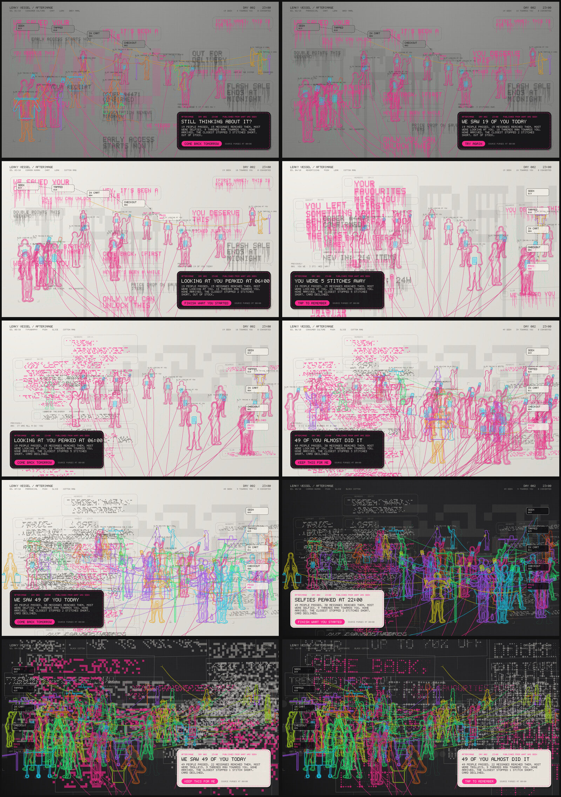

# Leaky Vessel / Afterimage

The third platform work in the *Leaky Vessel* series, after [Touchpoints](../README.md) and [Loose Thread](../loose-thread/README.md). It is ten editions at 1920 × 1080. It is a self-contained p5.js sketch for EditART, other online generative-art platforms and gallery screens, and it exports print-resolution files for giclée. It uses no server, camera, network or external font.

## What is on the cloth

- **The messages.** A day of customer communication: shipping notices, price drops, one-time codes, loyalty points, and the parasocial lines that talk as if they know you (`WE MISSED YOU`, `[FIRST NAME], THIS IS FOR YOU`). They arrive through one channel's architecture: notification cards, inbox rows, chat bubbles, banners or billboards. They are set in the series' 5×7 face as flat printed modules, then taken apart by one typographic operation. A single hero word (`NOW`, `SAVE`, `YOU`…) sits huge behind them.
- **The people.** Drawn in fluorescent cotton thread. Each body is a union of soft capsules. Its outline, and one or two echoes inside it, are traced as contours, so each figure is organic and has no gender. Their activities are consumer ones: scrolling, taking a selfie, scrolling on the sofa, walking on a call, scanning a code, tapping a card, carrying bags, opening a box, trying something on, queueing, pushing a trolley, reaching for a shelf. The ones who look at you face out of the frame. Devices and goods are laid in a second thread colour, and screens glow.
- **The system, designed to fail.** Each person runs a thread towards a message, towards a stage of the funnel (`SEEN → TAPPED → IN CART → CHECKOUT → PAID`), or out of the frame towards **YOU**. Every thread stops 50–97.5% of the way and frays. The link into `PAID` always breaks, with a reason (`SESSION EXPIRED`, `CARD DECLINED`…). The counter reads `0 CONVERTED`.
- **The vision loop.** At 23:00 detection brackets close around everyone, with a confidence score and a label (the sixteen most confident are named). A notification is then published as an appliqué patch: a **headline**, **body copy** and a **call to action**, written only from counts. The counts are how many passed, how many messages reached them, what most of them were doing, how many threads ran towards you, and how many stitches short the closest one stopped.
- **The purge and the afterimage.** At midnight the stitches are unpicked and the messages fade. What survives is an afterimage: every figure of the day as needle holes in its complementary colour (same lightness, opposite hue, like a retinal afterimage), plus one figure kept at reduced strength. The system keeps the one closest to converting unless the viewer clicked another. Earlier headlines are listed above the patch and lose `1 − 0.86^age` of their letters each day (capped at 92%).

The still shows the moment of publication on day 2, so day 1's afterimage and one archived headline are already present. On screen the work then runs: 16 s hold, 6 s purge, then the next day is stitched from 06:00 to 23:00 in 30 s, followed by the scan and the typing of the next notification.

## The chain: one element per slider

| Slider | Element | What it controls |
|---|---|---|
| `m0` | Consumer culture | How many people (10–62) and messages (9–39), and where everyone stands |
| `m1` | Parasocial | The share who speak and look as if they know **YOU** (4–90%). Their thread is pink and runs out of the frame towards the viewer, and their messages are set in pink |
| `m2` | Common human | The busiest hour (06:00 → 23:00) and the ground lived on at that hour: cotton rag, calico, grey marl, indigo, black cotton. The light falls from the side of the busiest hour |
| `m3` | Advertising | The channel (push, inbox, chat, banner, billboard), where the funnel hangs, and what people are doing: screen, hand or street activities |
| `m4` | Typography | The operation on the 5×7 face: SLICE, OVERPRINT, LEAK, PERFORATE, DECAY. The position within each fifth sets its intensity |

Each element draws from its own random stream, so moving one slider changes only that element. The published notification reads the whole composite.

## The ten editions

Each edition moves exactly one slider from the edition before it, walking the chain twice from the midpoint. Open one with `index.html#ed=N`.

| Ed. | Element moved | m0 | m1 | m2 | m3 | m4 | Result |
|---|---|---|---|---|---|---|---|
| 01 | Consumer culture | **0.215** | 0.500 | 0.500 | 0.500 | 0.500 | 19 people, chat, LEAK, grey marl |
| 02 | Parasocial | 0.215 | **0.880** | 0.500 | 0.500 | 0.500 | almost everyone looks at you |
| 03 | Common human | 0.215 | 0.880 | **0.070** | 0.500 | 0.500 | an early-morning life, cotton rag |
| 04 | Advertising | 0.215 | 0.880 | 0.070 | **0.110** | 0.500 | push cards, the funnel on the right |
| 05 | Typography | 0.215 | 0.880 | 0.070 | 0.110 | **0.070** | SLICE |
| 06 | Consumer culture | **0.780** | 0.880 | 0.070 | 0.110 | 0.070 | a crowd of 49 |
| 07 | Parasocial | 0.780 | **0.240** | 0.070 | 0.110 | 0.070 | the crowd turns away, colour returns |
| 08 | Common human | 0.780 | 0.240 | **0.930** | 0.110 | 0.070 | a night life, black cotton |
| 09 | Advertising | 0.780 | 0.240 | 0.930 | **0.870** | 0.070 | billboards, street activities |
| 10 | Typography | 0.780 | 0.240 | 0.930 | 0.870 | **0.710** | PERFORATE: the final work |

The same values are valid EditART slider settings (`?m0=0.215&m1=0.500&…`), so each edition can be minted or reproduced there.

## Screen and print

- **Screen.** Serve the repository root (`python3 -m http.server`) and open `/afterimage/`. The 16:9 composition is letterboxed to any window. Hover over a figure to see its activity, time and how far its thread got. Click a figure to keep it as tomorrow's afterimage. `S` saves 1920 × 1080.
- **Print.** `P` saves the still at 4×, or at the scale given by `#print=N` (2–8). The PNG carries a 300 dpi tag. Everything is drawn as vectors, so it is redrawn at that scale, not enlarged:

  | Scale | Pixels | At 300 dpi |
  |---|---|---|
  | 4× | 7680 × 4320 | 25.6 × 14.4 in (65.0 × 36.6 cm) |
  | 6× | 11520 × 6480 | 38.4 × 21.6 in (97.5 × 54.9 cm) |
  | 8× | 15360 × 8640 | 51.2 × 28.8 in (130.0 × 73.2 cm); needs about 0.5 GB of browser memory |

- **Headless.** `node tools/render-afterimage.mjs 4 out/` renders all ten editions at 4× (about 40 MB and 10 s each). Add `1,5,10` to choose editions. It needs Playwright.
- **Upload.** `./pack.sh` builds `dist/` and `afterimage.zip` with p5 and `editartParams.js` copied in.

### Printing fluorescent colour on Hahnemühle

The thread colours are sRGB neons. Giclée on Hahnemühle papers is printed with pigment inkjet sets, which have no fluorescent inks, so the pinks, greens and yellows fall outside the printable gamut and will come out duller than on screen. Before an edition run:

1. Soft-proof each file in Photoshop or your RIP with the printer's ICC profile for the exact paper, and adjust saturation per edition under the proof. Do not adjust the screen master.
2. Matte cotton papers such as Photo Rag have a smaller gamut and a shallower black than baryta papers. Editions 08–10 (black cotton) and 01–02 (grey marl) depend on a deep black and saturated thread, so test them on a baryta stock as well before choosing.
3. If the neon has to read as neon on paper, print the giclée and add the thread colours as a fluorescent screenprint overprint, as a hybrid edition. This is an option to discuss with the print studio. The files do not separate the colours for it.

## Rules

- **Determinism.** Everything depends only on `m0`–`m4` and the seed in `index.html`, except which figure the viewer keeps. The still does not depend on timing: two loads give identical files (checked headless).
- **Options** go in the URL hash, because EditART's query string may hold only `m0`–`m4`: `#ed=N`, `#still` (no animation), `#print=N` (export on load).
- All copy is original and generic. No real brands or slogans are used.

## Relation to the installation

In the installation version ([`../leaky-vessel/`](../leaky-vessel/README.md)), a camera watches the artist's room and a vision model writes the daily log before the source images are deleted. In this edition the loop is simulated inside the sketch, so it can run on a platform with no network. The copywriter sees only its own stitched figures, and nothing outside the sketch is captured or stored.
